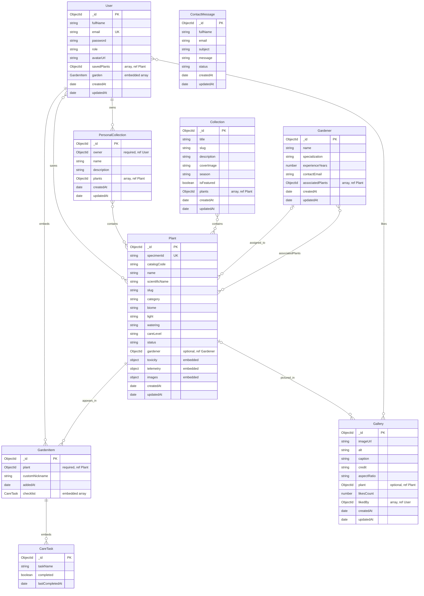

# GreenNest database diagram

GreenNest stores application data in MongoDB. This ERD shows the seven Mongoose collections and the two subdocument types defined in `backend/src/modules`. Lines between collections represent Mongoose `ObjectId` references, not database-enforced foreign keys. `GardenItem` and `CareTask` are embedded inside `User` documents and are not separate collections.

## Reading the diagram

- `User.garden` embeds garden entries; each entry must reference one `Plant` and embeds its care checklist.
- `User.savedPlants`, `Collection.plants`, `PersonalCollection.plants`, `Gallery.likedBy`, and `Gardener.associatedPlants` are arrays of references.
- `Plant.gardener` and `Gardener.associatedPlants` are separate references in opposite directions. The schema alone does not guarantee they remain synchronized.
- `Gallery.plant` is optional. `ContactMessage` has no model reference to `User`; its `email` is plain text.
- Additional scalar and nested `Plant` fields, including descriptions, origin, care details, traits, tags, and image URLs, are omitted from the diagram for readability. See `backend/src/modules/plant/plant.model.js` for the full schema.
