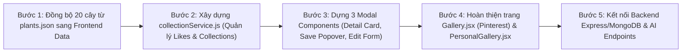

# KẾ HOẠCH PHÁT TRIỂN TÍNH NĂNG GALLERY (PINTEREST-STYLE), USER COLLECTIONS & AI INTEGRATION

> **Dự án:** GreenNest (*The Living Canopy - GreenNest Herbarium*)[cite: 1]  
> **Cập nhật theo phiên bản Git:** Nhánh `main` - Commit `0c1dc22`  
> **Nền tảng công nghệ:** React 19.2.8 + Vite + TailwindCSS 4.3.3 + React Router 7.18.4 + Node.js/Express + MongoDB + JWT Auth  
> **Mục tiêu tài liệu:** Đặc tả chi tiết luồng nghiệp vụ, giao diện UI/UX, cấu trúc dữ liệu (LocalStorage & MongoDB), danh sách RESTful API và lộ trình code cho trang `/gallery` kiểu Pinterest kết hợp tính năng tạo Collection cá nhân hóa[cite: 1, 2].

---

## 1. TỔNG QUAN NGHIỆP VỤ & SỰ PHỐI HỢP GIỮA GALLERY VÀ COLLECTION

Sau đợt tái cấu trúc mã nguồn ở commit `0c1dc22`, dự án đã tách riêng trang danh mục kỹ thuật sang `/plants` (`Plants.jsx`) và dành riêng đường dẫn `/gallery` (`Gallery.jsx`) cho tính năng thư viện ảnh tương tác (FRS 6)[cite: 2]. Đồng thời, hệ thống đã có sẵn `AuthContext.jsx` quản lý phiên đăng nhập (`user`, `token`, `isAuthenticated`, `isAdmin`) và bộ dữ liệu chuẩn 20 cây cảnh trong `database/seedData/plants.json`[cite: 2].

Hệ thống mới kết hợp **Gallery** và **User Collection** theo mô hình **Pin & Board của Pinterest**:

1. **Trang `/gallery` (`Gallery.jsx`) – Tường khám phá hình ảnh (Pinterest Feed):**
   - Hiển thị hình ảnh cây cảnh dưới dạng lưới bất đối xứng (Masonry Grid).
   - Mỗi thẻ ảnh hiển thị **Ảnh cây**, **Tên cây**, **Nút thả tim + Số lượt tim** và nút nổi **"Lưu vào Collection" (Save)**.
   - Khi bấm vào ảnh cây, một **Card chi tiết cây (Interactive Lightbox Modal)** hiện lên hiển thị toàn bộ thông tin sinh trưởng, chăm sóc và cho phép lưu cây vào Collection ngay lập tức (đáp ứng nâng cao cho **FRS 6**)[cite: 1, 2].
2. **Tính năng `Collection` (`PersonalGallery.jsx`) – Bộ sưu tập cá nhân (Pinterest Boards):**
   - Cho phép mỗi người dùng tạo **nhiều Collection khác nhau** phục vụ các mục đích riêng (VD: *"Cây để bàn làm việc"*, *"Ban công hướng Tây"*, *"Cây an toàn cho thú cưng"*).
   - Mỗi Collection cho phép người dùng tự đặt **Tên (`name`)** và **Mô tả (`description`)** riêng, lưu trữ các cây lấy từ trang Gallery (đáp ứng nâng cao cho **FRS 9**)[cite: 1].
3. **Phân tách rõ với dữ liệu hệ thống hiện hữu:**
   - Giữ nguyên `database/seedData/plantCollections.json` (chứa 4 bộ sưu tập theo mùa: `spring-collection`, `summer-collection`, `autumn-collection`, `winter-collection`) để phục vụ **FRS 8 (Seasonal Gardening Collections)**[cite: 1, 2].
   - Tạo cấu trúc dữ liệu mới `userCollections` dành riêng cho các bộ sưu tập cá nhân của từng tài khoản người dùng[cite: 2].

---

## 2. THIẾT KẾ CHI TIẾT TRANG GALLERY KIỂU PINTEREST (`Gallery.jsx`)

### 2.1. Đồng bộ nguồn dữ liệu hiển thị (Data Hydration)
- **Khắc phục lệch dữ liệu:** Hiện tại `frontend/src/data/botanicalSpecimens.js` mới chỉ có 4 cây mẫu, trong khi `database/seedData/plants.json` đã có đủ 20 cây hoàn chỉnh[cite: 1, 2].
- **Nguồn ảnh cho Gallery:** Hợp nhất dữ liệu từ 20 cây chuẩn trong `database/seedData/plants.json` (mỗi cây gồm mảng `images`, `slug`, `name`, `botanicalName`, `category`, `light`, `water`, `difficulty`, `seasons`, `tags`, `guide`, `similarPlantSlugs`) với danh sách cây do Admin thêm mới trong `greenNest_custom_specimens` (từ `AdminDashboard.jsx`)[cite: 2].

### 2.2. Giao diện Masonry Grid & Thẻ Cây (Gallery Pin Card)
Tuân thủ quy chuẩn thiết kế **"Editorial Botanist / Anti-AI Slop"** với nền tối (`#07100b`, `#0e1e16`), điểm nhấn xanh Emerald (`#22c55e`), Light green (`#86efac`) và Gold/Amber[cite: 1]:

1. **Thanh lọc & Sắp xếp nhanh (Gallery Filter Bar):**
   - Cho phép lọc nhanh các thẻ ảnh trên Gallery theo `category`, `seasons` (`spring`, `summer`, `autumn`, `winter`) hoặc `tags`[cite: 2].
   - Cho phép sắp xếp theo: *Phổ biến nhất (Nhiều tim nhất)*, *Mới nhất*, hoặc *Độ khó chăm sóc (`difficulty`)*[cite: 2].
2. **Bố cục Lưới Masonry (Pinterest Layout):**
   - Sử dụng TailwindCSS 4 (`columns-1 sm:columns-2 md:columns-3 lg:columns-4 gap-5 space-y-5`) để các thẻ ảnh cây có tỷ lệ khung hình khác nhau tự động xếp khít theo chiều dọc[cite: 1].
3. **Cấu trúc Thẻ Cây trên Gallery (Pin Item):**
   - **Hình ảnh chính:** Hiển thị ảnh từ mảng `images` của cây kèm `alt` text chuẩn[cite: 1, 2].
   - **Hiệu ứng Hover (Pinterest Overlay):**
     - Khi di chuột vào ảnh, góc trên bên phải xuất hiện nút **"Lưu / Save"** (màu Emerald `#22c55e` hoặc Amber) để mở nhanh Popover lưu vào Collection[cite: 1].
   - **Chân thẻ (Card Footer - Luôn hiển thị):**
     - **Bên trái:** Tên thường gọi (`name`) dùng font tiêu đề (Outfit / Playfair Display) và tên khoa học (`botanicalName`) in nghiêng bên dưới[cite: 1, 2].
     - **Bên phải:** Nút **Thả tim (Heart Button)** kèm bộ đếm **Số lượt tim (`likesCount`)**. Khi bấm vào sẽ đổi trạng thái yêu thích và tăng/giảm số tim ngay lập tức (Optimistic UI).

### 2.3. Card Thông Tin Chi Tiết Cây (Plant Detail Lightbox Modal)
Khi người dùng click vào bất kỳ ảnh cây nào trên `Gallery.jsx`, hệ thống mở một **Modal Card 2 cột** (kết hợp giữa Pinterest Pin Detail và yêu cầu kỹ thuật của **FRS 4 & FRS 6**)[cite: 1, 2]:

- **Cột Trái – Trình xem ảnh tương tác (FRS 6):**
  - Hiển thị ảnh độ phân giải cao kèm chú thích (`caption`), `altText` và nguồn ảnh (`credit`)[cite: 1].
  - Nếu cây có nhiều ảnh trong mảng `images`, hiển thị thanh thumbnail chuyển ảnh[cite: 2].
  - Hỗ trợ điều khiển bàn phím đầy đủ: Phím `Esc` để đóng Card, phím mũi tên `←` / `→` để chuyển sang cây tiếp theo/trước đó trong Gallery[cite: 1].
- **Cột Phải – Hồ sơ Thực vật & Tương tác:**
  - **Thanh công cụ đầu Card:**
    - Nút **Thả tim + Số lượt tim**.
    - Nút **"Lưu vào Collection" (Save to Collection)** kèm hiển thị tên Collection nếu cây này đã được lưu trước đó.
  - **Thông tin định danh:** `name`, `botanicalName`, huy hiệu độ khó (`difficulty`), danh mục (`category`) và các `tags`[cite: 2].
  - **Thông số nhanh (Quick Badges):** Yêu cầu ánh sáng (`light`), chế độ tưới (`water`), mùa sinh trưởng (`seasons`)[cite: 2].
  - **Hướng dẫn chăm sóc chi tiết (Trích xuất từ sub-document `guide` trong `plants.json`):**
    - Môi trường sống (`environments`) & Tập tính sinh trưởng (`growthHabit`)[cite: 2].
    - Đất trồng (`soil`) & Loại chậu phù hợp (`container`)[cite: 2].
    - Cách tưới (`watering`) & Chăm sóc định kỳ (`routineCare`)[cite: 2].
    - Cảnh báo độc tính (`toxicityCaution` - tô màu cảnh báo Gold/Amber)[cite: 1, 2].
  - **Cây có chế độ chăm sóc tương tự (`similarPlantSlugs` - FRS 4):** Hiển thị danh sách thẻ nhỏ các cây tương tự; click vào sẽ đổi nội dung Card sang cây đó ngay lập tức[cite: 1, 2].
  - **Nút điều hướng mở rộng:** Nút dẫn tới trang chi tiết toàn màn hình (`/plants/:slug` - `SpecimenDetail.jsx`) hoặc thêm vào vườn chăm sóc (`/garden` - `Garden.jsx`)[cite: 1, 2].

---

## 3. THIẾT KẾ CHI TIẾT TÍNH NĂNG BỘ SƯU TẬP CÁ NHÂN (USER COLLECTIONS)

### 3.1. Luồng tạo & Lưu cây vào Collection từ Gallery (`SaveToCollectionModal.jsx`)
Khi người dùng bấm nút **"Lưu / Save"** trên thẻ cây ở `Gallery.jsx` hoặc bên trong Card chi tiết cây[cite: 2]:
1. **Kiểm tra xác thực (`useAuth()` từ `AuthContext.jsx`):**
   - Nếu đã đăng nhập (`isAuthenticated === true`), gắn dữ liệu Collection theo `user.email` (hoặc `user.id`)[cite: 2].
   - Nếu chưa đăng nhập, cho phép lưu vào phiên khách (`guest` trong `localStorage`) kèm thông báo gợi ý đăng nhập tại `/login` để đồng bộ lâu dài[cite: 1, 2].
2. **Giao diện chọn Collection (Popover / Modal):**
   - Hiển thị danh sách toàn bộ các Collection hiện có của người dùng.
   - Mỗi dòng hiển thị: Ảnh bìa thu nhỏ + **Tên Collection (`name`)** + Số lượng cây hiện có + Icon đánh dấu nếu cây đang chọn đã nằm trong Collection đó (cho phép 1 cây nằm trong nhiều Collection khác nhau).
   - **Form "+ Tạo Collection mới" tích hợp ngay trong Modal:**
     - Ô nhập **Tên Collection (`name`)** *(Bắt buộc, tối đa 60 ký tự)*.
     - Ô nhập **Mô tả (`description`)** *(Tùy chọn, tối đa 250 ký tự, giải thích mục đích của bộ sưu tập)*.
     - Nút **"Tạo & Lưu cây"**: Vừa khởi tạo Collection mới, vừa tự động thêm cây đang chọn vào Collection đó.

### 3.2. Trang Quản lý các Bộ sưu tập cá nhân (`PersonalGallery.jsx`)
Nâng cấp trang `PersonalGallery.jsx` hiện tại thành trung tâm quản lý Collection cá nhân chuẩn phong cách Pinterest Boards[cite: 1]:
1. **Giao diện Danh sách Collection (Boards Grid View):**
   - Nút **"+ Tạo Collection Mới"** ở góc trên bên phải trang.
   - Hiển thị lưới các thẻ Collection của user:
     - **Khung ảnh ghép (Collage Preview):** Hiển thị 3 ảnh đại diện lấy từ 3 cây đầu tiên trong Collection (1 ảnh lớn bên trái, 2 ảnh nhỏ xếp chồng bên phải). Nếu Collection chưa có cây nào, hiển thị khung placeholder mang họa tiết thực vật tối màu (`#0e1e16`)[cite: 1].
     - **Thông tin Collection:** Tên Collection (`name`), đoạn mô tả mục đích (`description`), tổng số cây đã lưu (`X specimens`) và thời gian cập nhật.
     - **Nút Quản trị Collection:** Chỉnh sửa Tên / Mô tả (`Edit`) và Xóa Collection (`Delete` kèm xác nhận).
2. **Giao diện Chi tiết 1 Collection (Collection Detail View):**
   - Khi bấm vào một thẻ Collection, hiển thị phần Header gồm **Tên Collection**, **Mô tả đầy đủ (`description`)**, nút **Chỉnh sửa thông tin Collection** và nút **"+ Thêm cây từ Gallery"** (dẫn về `/gallery`)[cite: 2].
   - Bên dưới hiển thị lưới các cây thuộc Collection đó. Người dùng có thể:
     - Bấm vào cây để mở lại **Card thông tin chi tiết cây**.
     - Gỡ cây khỏi Collection hiện tại (nút `Remove from Collection`).
     - Lọc nhanh các cây bên trong Collection theo ánh sáng (`light`) hoặc lượng nước (`water`)[cite: 2].

---

## 4. CẤU TRÚC CƠ SỞ DỮ LIỆU & RESTFUL API (HYBRID STORAGE + MONGODB)

Thiết kế dữ liệu tương thích đồng thời với cơ chế `localStorage` hiện tại ở Frontend và đặc tả MongoDB trong `database/` cùng `docs/api-contract.yaml`[cite: 1, 2]:

### 4.1. Cấu trúc Schema `userCollections` (MongoDB & LocalStorage)
```json
{
  "_id": "ucol_01",
  "userId": "alex.pham@example.com",
  "name": "Góc Làm Việc Thiếu Sáng",
  "description": "Tổng hợp các dòng cây lá kiểng chịu bóng bán phần, sống tốt dưới đèn văn phòng và ít cần tưới nước.",
  "coverImage": "/assets/plants/monstera.jpg",
  "plantSlugs": [
    "monstera-deliciosa",
    "snake-plant",
    "zz-plant"
  ],
  "createdAt": "2026-10-15T12:00:00.000Z",
  "updatedAt": "2026-10-15T14:20:00.000Z"
}
```

### 4.2. Cấu trúc dữ liệu Lượt Tim trên Gallery (`galleryLikes`)
- Bổ sung vào mỗi bản ghi cây trong `plants.json` / Collection `plants` (MongoDB)[cite: 2]:
  - `likesCount`: `Number` (Khởi tạo giá trị ngẫu nhiên có chủ đích từ `18` đến `145` cho 20 cây mẫu để giao diện Gallery sinh động ngay từ đầu)[cite: 2].
  - `likedBy`: `Array<String>` (Lưu danh sách `email` hoặc `userId` của người dùng đã thả tim)[cite: 2].
- **Keys lưu trữ tại `localStorage` (Khi chạy chế độ Client-side / Chưa bật Backend)[cite: 1, 2]:**
  - `greenNest_user_collections`: Object ánh xạ `{ [userEmail]: [UserCollection, ...] }`.
  - `greenNest_gallery_likes`: Object ánh xạ `{ [plantSlug]: { likesCount: Number, likedBy: [userEmail] } }`.

### 4.3. Bảng Đặc Tả RESTful API Bổ Sung (Cập nhật vào `docs/api-contract.yaml`)
Bổ sung các endpoints sau vào nhóm `Gallery` và `Collections` trong `docs/api-contract.yaml` và Backend Express[cite: 1, 2]:

| Phân hệ | Method & Endpoint | Xác thực | Mô tả chức năng |
|---|---|---|---|
| **Gallery Feed** | `GET /api/gallery` | Public / Optional JWT | Trả về danh sách 20+ cây kèm mảng `images`, `likesCount`, cờ `isLikedByMe` và danh sách `savedCollectionIds` của user hiện tại[cite: 2]. |
| **Gallery Like** | `POST /api/gallery/:slug/like` | JWT Required (`AuthContext`)[cite: 2] | Toggle thả tim / bỏ tim cho cây có `slug` tương ứng, trả về `likesCount` mới. |
| **Get User Collections** | `GET /api/user/collections` | JWT Required | Lấy toàn bộ danh sách Collection do user đang đăng nhập tạo (kèm thông tin tóm tắt các cây bên trong). |
| **Create Collection** | `POST /api/user/collections` | JWT Required | Tạo Collection mới với body `{ name, description, initialPlantSlug }`. |
| **Update Collection** | `PUT /api/user/collections/:id` | JWT Required | Cập nhật `name`, `description` hoặc `coverImage` của một Collection. |
| **Delete Collection** | `DELETE /api/user/collections/:id` | JWT Required | Xóa một Collection cá nhân của user. |
| **Toggle Plant in Collection** | `POST /api/user/collections/:id/plants` | JWT Required | Thêm hoặc xóa một `plantSlug` vào/khỏi Collection có mã `:id`. |

---

## 5. TÍCH HỢP AI HỖ TRỢ TRỰC TIẾP CHO GALLERY & USER COLLECTIONS

Để tính năng AI gắn kết chặt chẽ với luồng **Gallery & Collection** cũng như các trang `PlantMacro.jsx` và `Garden.jsx`[cite: 1]:

1. **AI Auto-Curator (Tự động khởi tạo Collection thông minh bằng AI trên `Gallery.jsx`):**
   - Người dùng nhập nhu cầu tự nhiên vào thanh công cụ trên Gallery (VD: *"Tạo giúp tôi bộ sưu tập cây lọc không khí cho phòng ngủ 15m2 có nuôi mèo"*).
   - AI phân tích trên tập 20 cây của `plants.json` (kiểm tra `light`, `water`, `guide.toxicityCaution`, `guide.environments`)[cite: 2], tự động lọc ra 3–5 cây phù hợp nhất và đề xuất nút **"Lưu thành Collection mới"** với `name` và `description` do AI biên tập sẵn chuẩn văn phong tạp chí thực vật[cite: 1].
2. **AI Leaf Doctor (Bác sĩ chẩn đoán lá cây bằng hình ảnh trên `PlantMacro.jsx` & `Garden.jsx`):**
   - Người dùng tải ảnh lá cây bị bệnh lên; AI Vision phân tích triệu chứng, trả về nguyên nhân và tự động thêm các đầu việc khắc phục vào **Interactive Care Checklist (FRS 13)**[cite: 1].
3. **Herbarium Curator Q&A (Hỏi đáp chuyên gia ngay trong Card Chi Tiết Cây):**
   - Ngay trong Modal Card khi bấm vào ảnh cây trên Gallery (hoặc tại `SpecimenDetail.jsx`), người dùng có thể đặt câu hỏi nhanh về cây đó; AI sử dụng dữ liệu `guide` của chính cây đang mở để trả lời chính xác[cite: 1, 2].

---

## 6. LỘ TRÌNH TRIỂN KHAI MÃ NGUỒN (STEP-BY-STEP IMPLEMENTATION PLAN)



### Bước 1: Đồng bộ hóa dữ liệu 20 cây từ `database/seedData/plants.json`[cite: 2]
- Cập nhật `frontend/src/data/botanicalSpecimens.js` để import/chuyển đổi toàn bộ 20 cây từ `database/seedData/plants.json` và 4 bộ sưu tập mùa từ `database/seedData/plantCollections.json`[cite: 1, 2].
- Khởi tạo trường `likesCount` mặc định cho từng cây và hàm helper gộp thêm dữ liệu từ `greenNest_custom_specimens` (do Admin tạo trong `AdminDashboard.jsx`)[cite: 2].

### Bước 2: Xây dựng lớp dịch vụ `frontend/src/services/collectionService.js`
- Kết nối với thông tin người dùng từ `AuthContext.jsx` (`user.email`)[cite: 2].
- Cung cấp đầy đủ các hàm CRUD cho Collection cá nhân và hàm Toggle Like trên Gallery:
  - `getGalleryFeed(userEmail)`: Trả về danh sách cây kèm trạng thái đã thả tim (`isLiked`) và danh sách Collection đã lưu cây đó.
  - `toggleLikePlant(userEmail, plantSlug)`: Xử lý thả tim / bỏ tim.
  - `getUserCollections(userEmail)`: Lấy danh sách Collection của user (khởi tạo sẵn 1 Collection mặc định nếu user chưa có).
  - `createUserCollection(userEmail, { name, description, initialPlantSlug })`: Tạo mới Collection.
  - `updateUserCollection(userEmail, collectionId, { name, description })`: Sửa tên và mô tả.
  - `deleteUserCollection(userEmail, collectionId)`: Xóa Collection.
  - `togglePlantInCollection(userEmail, collectionId, plantSlug)`: Thêm/gỡ cây khỏi Collection.

### Bước 3: Xây dựng các Component dùng chung trong `frontend/src/components/gallery/`
1. **`GalleryPinCard.jsx`**: Thẻ ảnh cây phong cách Pinterest có hiệu ứng hover hiện nút "Save", chân thẻ hiện tên cây và nút thả tim kèm số lượng.
2. **`PlantDetailModal.jsx`**: Card thông tin chi tiết cây hiện lên khi click vào ảnh trên Gallery (hỗ trợ phím `Esc`, `←`, `→` theo FRS 6, hiển thị đầy đủ thông số `guide` và `similarPlantSlugs` theo FRS 4)[cite: 1, 2].
3. **`SaveToCollectionModal.jsx`**: Hộp thoại cho phép tick chọn lưu cây vào nhiều Collection hoặc nhập `name` + `description` để tạo Collection mới ngay tại chỗ.

### Bước 4: Hoàn thiện `Gallery.jsx` và `PersonalGallery.jsx`
1. **Trang `frontend/src/pages/Gallery.jsx`[cite: 2]:**
   - Tích hợp thanh lọc nhanh (Category, Season, Sort by Likes)[cite: 2].
   - Render lưới Masonry gồm 20+ thẻ `GalleryPinCard`.
   - Quản lý state mở `PlantDetailModal` khi bấm vào ảnh và `SaveToCollectionModal` khi bấm nút Lưu.
2. **Trang `frontend/src/pages/PersonalGallery.jsx`[cite: 1]:**
   - Chuyển đổi sang giao diện quản lý các **User Collections (Boards)** với khung ảnh ghép 3 ô, hiển thị rõ **Tên (`name`)** và **Mô tả (`description`)** của từng Collection.
   - Cho phép bấm vào từng Collection để xem danh sách cây bên trong, chỉnh sửa thông tin Collection hoặc xóa cây.